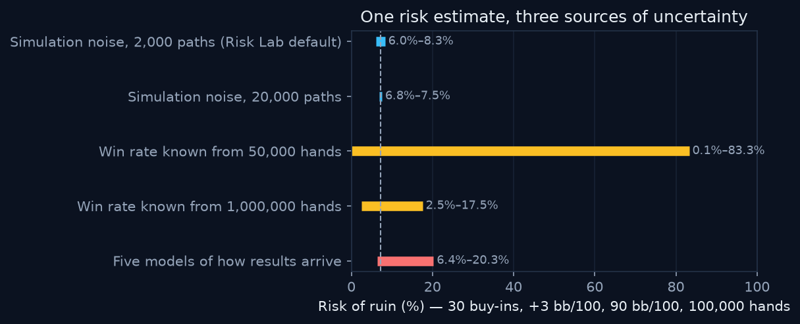

# Poker Risk Lab: Understanding Uncertainty in Simulation

**How much should we trust a simulated risk estimate?** An interactive study of
how numerical error, uncertain inputs and modelling assumptions affect a
bankroll-risk estimate. Poker is the setting; the methods apply to any
simulated risk with an absorbing boundary.



**Main finding.** For one scenario (30 buy-ins, +3 bb/100, 90 bb/100 swings,
100,000 hands; exact model risk 7.17%), a single simulation at the default
2,000 paths lands within about ±1.13 points of the exact value. Not knowing the
win rate after 50,000 hands leaves anything from 0.1% to 83.3% plausible, and
five models of how results arrive give 6.4% to 20.3%. More computing only fixes
the first.

**How a misleading result was checked.** After an engine update the same seed
gave a lower risk (7.85% → 6.35%); switching the two changes on separately and
rerunning 40 seeds showed the drop was sampling, and the corrected engine
averages 7.12% against the exact 7.17% (6.76% without the correction).

| | |
|---|---|
| **Case study** | [`case-study/index.html`](case-study/index.html): three questions, one at a time, plus how a misleading result was checked. Static page: open the file directly, or `/case-study/` on the running app. |
| **Validation** | [`case-study/validation.html`](case-study/validation.html): PokerKit cross-checks (hands, equity, ranges), exact-value checks, interval coverage, engine agreement, the bankroll-from-results page and the session import against the Python research code, a simulation of unequal session lengths, and benchmark conditions. A failed check is shown as failed and stops the build. |
| **Demo** | `npm start`, then <http://localhost:4174>. No public deployment URL yet. |
| **Reproduce** | `pip install -r requirements-research.txt`, `python -m src.experiments.case_study --case all`, then `npm run build`. Every check in [`checks/`](checks/README.md) has its own command and saved output. |
| **Limits** | Conditional model estimates, not advice. The alternative models are stress tests, not descriptions of real games. The Preflop ranges are demonstration data. |

## Authorship and AI assistance


## Research framing

**Research question:** *How reliable are finite-horizon ruin-risk estimates when
the stochastic model, the estimated edge, the barrier-monitoring frequency, and
the simulation budget are all imperfect?*

A reproducible computational-statistics framework for estimating finite-horizon
ruin risk under **parameter uncertainty, model misspecification, and discrete
barrier monitoring**. Poker bankroll management is the concrete case study; the
methods apply to any stochastic process with an absorbing lower boundary —
capital depletion, insurance reserves, inventory exhaustion, reliability
thresholds. The current experiments are calibrated to bankroll processes; the
software architecture is extensible, and we do not overclaim domain generality.

The intellectual contribution is framed generally as *uncertainty-aware risk
estimation for stochastic systems with absorbing boundaries*, demonstrated
through four strands: (1) mathematical modeling, (2) statistical inference under
parameter uncertainty, (3) numerical/computational validation, and
(4) reproducible scientific software. See [`docs/methodology.md`](docs/methodology.md).
The quick-run figures in `reports/figures/` predate the bridge correction and
show no intervals; the case study uses the regenerated results in
`reports/case-study/`.

> Research and educational tool. Results depend on simplified model assumptions
> and are **not** financial or gambling advice.

> **Calculation engine update (2026-10-21):** bankroll results now count dips
> to the ruin threshold between 100-hand checkpoints and use new random-number
> streams, so the same settings and seed give different numbers than earlier
> versions. See [`CHANGELOG.md`](CHANGELOG.md) for the before/after figures and
> what they do and do not mean, and
> [`checks/calculation-change-2026-10-21/`](checks/calculation-change-2026-10-21/README.md)
> for the script and saved output that reproduce them.

---

*The section below documents the original decision-support tool, which remains
the product layer over the research engine.*

## Poker Bankroll Risk Simulator (product layer)

---

## Product questions this supports

- How likely am I to reach the ruin threshold under my current bankroll and edge?
- How much drawdown should I realistically prepare for (P75 / P90 / P95 / P99)?
- How sensitive is bankroll survival to uncertainty in my win rate?
- How different are mean outcomes from median outcomes on a skewed distribution?
- When does the finite-horizon estimate diverge from the classic infinite-horizon
  gambler's-ruin formula, and why?

This models **cash-game bankroll variance only** — not tournaments or ICM.

---

## Methodology

**Bankroll process.** The bankroll is measured in big blinds (bb) and evolves in
discrete steps of `step_hands` hands. Each step applies an i.i.d. Normal increment:

```
increment ~ Normal(mean = winrate_bb100 * step_hands / 100,
                    std  = std_bb100 * sqrt(step_hands / 100))
```

**Absorbing ruin.** A path is ruined the first time its bankroll is `<=`
`ruin_threshold_bb`. Ruin is absorbing: the path is clipped to the threshold for
all subsequent steps and can never recover. Terminal bankroll is defined
consistently for survivors and ruined paths.

**Continuous monitoring.** By default (`bridge=True`) ruin is also detected
*between* step ends: when a step starts and ends above the threshold, the path
is ruined with the Brownian-bridge probability `exp(-2 a0 a1 / s2)` that it
touched the threshold in between. Endpoint-only monitoring (`bridge=False`)
underestimates first-passage risk; on 200k-path checks it ran 5–36 standard
errors below the finite-horizon Brownian benchmark, while the bridge-corrected
estimate stayed within 1 standard error. The web engine (`server/compute.js`)
uses the same correction.

**Monte Carlo estimation.** The engine is fully vectorized (`np.random.default_rng`,
no per-path Python loops, optional path-chunking with a memory guard). Risk of ruin
is the fraction of ruined paths, with a path-level **bootstrap** confidence interval
(or a fast **Wilson** binomial interval for large path counts).

**Drawdown.** Maximum drawdown is measured from each path's prior running peak on the
absorbed path; percentage drawdown uses a safe denominator. Ruined paths are never
silently treated as recovered.

---

## Validation

Three methods are reported side by side because they answer *slightly different
questions*:

| Method | Question it answers |
|---|---|
| **Monte Carlo, finite horizon** | Simulated ruin rate over exactly `n_hands`. |
| **Brownian, finite horizon** | First-passage probability of hitting the barrier by time `T = n_hands`. Most directly comparable to Monte Carlo. |
| **Brownian, infinite horizon** | Classic gambler's ruin `exp(-2 mu b / sigma^2)`; assumes unbounded time, so tends to 1 for zero/negative drift. |
| **Markov chain, finite step** | Absorption probability on a discretized bankroll grid, iterated for the same number of steps. |

Differences are expected. The infinite-horizon estimate is an **upper bound** on the
finite-horizon result and is *not* a validation failure when it comes out higher.
Consistency is judged with neutral language ("consistent within simulation
uncertainty", "directionally consistent", or "difference likely reflects
finite-horizon or discretization assumptions"). Actual numbers appear only after
running `scripts/run_validation.py` — none are hard-coded here.

Unit conventions (per hand): `mu = winrate_bb100 / 100`,
`sigma^2 = std_bb100^2 / 100`, `b = bankroll_bb - ruin_threshold_bb`, `T = n_hands`.

---

## Assumptions and limitations

- Results are i.i.d.; the model ignores autocorrelation and session dependence.
- The win rate is stationary — it ignores learning, fatigue, tilt, opponent
  adaptation, and game selection.
- The Normal increment may understate heavy tails.
- The estimated win rate itself carries sampling uncertainty (see the optional
  win-rate-uncertainty extension).
- Rake and changing game quality can make assumptions optimistic.
- Deposits, withdrawals, bet sizing, and moving between stakes are excluded unless
  explicitly modeled.
- This is cash-game variance, not tournament ICM.
- Outputs are conditional **model estimates**, not guarantees.

---

## Reproducibility

Every result is a deterministic function of the parameters and the seed:

```bash
python scripts/run_validation.py \
  --winrate 3.0 --std 90 --bankroll 3000 \
  --hands 100000 --paths 50000 --seed 42
```

## Poker Analytics Suite (private compute API)

The public page is a no-install interface backed by a private Node calculation
service. Visitors can inspect the normal HTML/CSS/UI JavaScript that their
browser receives, but the Equity evaluator, EV formulas, bankroll Monte Carlo,
and CFR implementation remain in the private server repository and are never
included in the public bundle. See [SECURE_DEPLOY.md](SECURE_DEPLOY.md) for the
deployment flow.

The main tabs are Risk Lab, Bankroll Risk, Hand Equity and Pot Odds & EV;
Preflop and About sit to the right as secondary tabs. Two routes run end to
end: *from your results* (Bankroll Risk) and *from an opponent's range* (Hand
Equity, then Pot Odds & EV). On both, a "What changed" box compares a new
result with the one shown before the edit and says why the answer moved.

- **Bankroll Risk** — starts from your own results: hands, net win rate and a
  volatility from your tracker or a labelled assumption, or a CSV of sessions
  (`hands`, `profit_bb`, optional stake, game and date) read in the browser,
  weighted by hands, filtered and compared by stake, game and period, with
  checks of whether the sessions fit the model. It gives the win
  rate's posterior interval, the average risk of ruin over it and the risk's
  posterior interval, and the bankroll for “risk below X% with Y% posterior
  probability” over the hands you plan to play, next to the average-risk and
  fixed-win-rate answers. Tables show how the answer changes with volatility,
  prior and sample size, plus a sample-size estimate for a given precision.
  These are exact for the model (closed form, no simulation;
  `server/bankroll_posterior.js`). The second mode is the Monte Carlo
  risk-of-ruin engine with a finite-horizon
  Brownian reference line. Like the Python engine, it monitors ruin
  continuously with a Brownian-bridge correction (the method from
  `barrier_resolution.py`), and its risk-versus-bankroll curve reuses the same
  simulated swings at every bankroll (common random numbers) with pointwise 95%
  Wilson intervals.
- **Hand Equity** — expected pot share against up to five fixed or random
  opponent hands, or one opponent's weighted range (`TT+, AQs+, AKo`, chart
  or top X%), and an optional board. Fixed heads-up spots and ranges from the
  flop on use exact enumeration; multiway and preflop range spots use seeded
  Monte Carlo. Range results show equity against each hand in the range.
- **Pot Odds & EV** — turns the latest card-derived equity into a call/fold
  decision with EV in big blinds; manual equity remains an advanced option.
- **Preflop** — browse, compare, and practise five 169-hand demonstration
  ranges. These illustrative frequencies validate the complete product workflow
  but are not solver-verified; the private API is ready for licensed solver
  exports to replace them later. An optional Kuhn poker demo runs CFR with a
  live convergence curve to the known game value (−1/18) and the equilibrium
  strategy table.

The private compute engines live in `standalone/engines/` and `server/compute.js`.
The server adds strict input limits, same-origin API enforcement, a bounded worker
queue, request-size limits, and in-memory rate limiting. Run all JavaScript checks with:

```bash
npm test
```

After editing the public shell or UI code, rebuild the public copies without
embedding the engines:

```bash
npm run build
```

This validates the evaluator/equity against published matchups (AA vs KK 82.6%,
72o vs AA 12%, MC ≈ exact) and CFR against the Kuhn equilibrium (value −1/18,
K bets 3× as often as J, Q checks first, K always calls).

## Two ways to use the bankroll tool

**A. Public web suite (no install).** Start it locally with `npm start`, or deploy
the private repository to Render. The server returns only result and chart data;
the public page cannot work correctly when opened directly as a `file://` URL or
deployed to static-only GitHub Pages. Internet is also used to load Plotly.

**B. Streamlit app (full engine).** Adds the Markov-chain validation, scenario
comparison, and file export on top of the exact Python engine that the tests
verify.

## Run the Streamlit app

```bash
pip install -r requirements.txt
streamlit run app.py
```

Expensive simulations run only when you click **Run simulation**; changing inputs
afterwards shows a "results are stale" banner until the next run. Results are
cached by their exact parameter tuple, so repeated runs are instant and
reproducible. Tabs: **Overview** (executive summary, six KPIs, path fan chart,
drawdown and terminal distributions, plain-language interpretation),
**Sensitivity** (risk-of-ruin curve with an x-axis toggle, win-rate uncertainty
sweep, required-bankroll solver, 2-D risk heatmap), **Scenario Comparison** (save
up to three scenarios), **Validation** (the four-method comparison table), and
**Methodology** (assumptions plus JSON / CSV / Markdown export).

Display units switch between buy-ins and big blinds; set the big-blind size to
show dollars. All amounts read in poker-player terms (buy-ins, bb/100) while the
engine works in big blinds internally.

## Testing

```bash
pip install -r requirements.txt
pytest
```

## Project structure

```
poker-bankroll-risk/
├── app.py              # Streamlit decision-support app (5 tabs)
├── .streamlit/config.toml   # dark quantitative theme
├── src/
│   ├── simulation.py   # vectorized Monte Carlo engine + SimulationConfig
│   ├── analytics.py    # risk of ruin, drawdown, growth, time-to-ruin
│   ├── validation.py   # Brownian (finite/infinite) + Markov cross-checks
│   ├── scenarios.py    # labelled illustrative presets
│   ├── sensitivity.py  # parameter sweeps + required-bankroll solver
│   ├── recommendations.py   # neutral risk classification + drivers
│   ├── plotting.py     # Plotly figures (dark theme)
│   └── formatting.py   # bb / buy-in / dollar formatting
├── scripts/
│   └── run_validation.py
├── tests/              # pytest: simulation, analytics, validation,
│                       #         sensitivity, edge cases (60 tests)
├── requirements.txt
└── pyproject.toml
```

Modules keep simulation, analytics, validation, plotting, and interpretation fully
separate — no plotting or global RNG inside the analytical functions. The app is a
thin, cached UI layer over these primitives.
